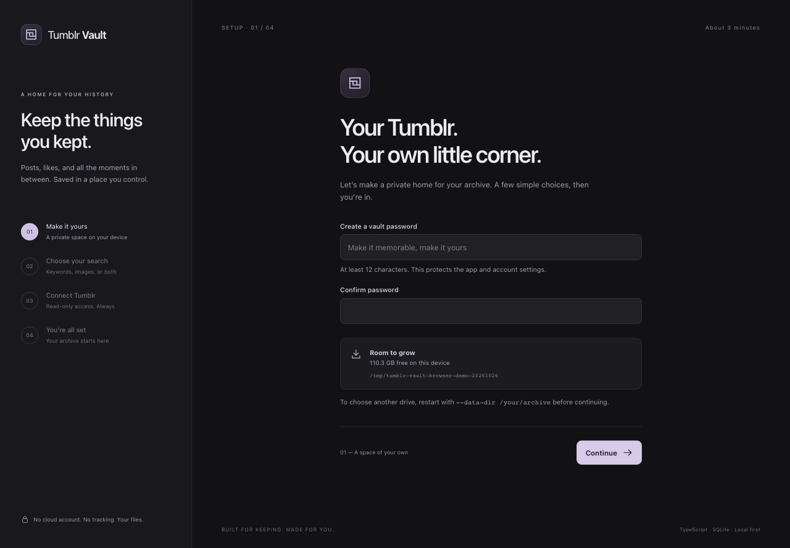
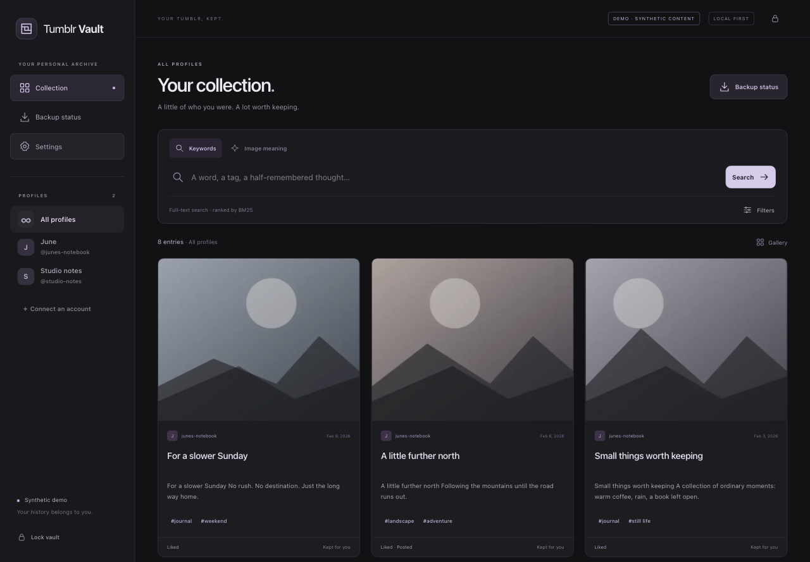

<div align="center">


**A home for the things you kept.**

Back up your Tumblr posts, likes and original media. Rediscover them in a quiet,
searchable reader that lives on your own device.

[](https://github.com/saphid/tumblr-vault/actions/workflows/ci.yml)
[](https://www.typescriptlang.org/)
[](https://nodejs.org/)
[](LICENSE)

[Get started](#five-minutes-to-your-own-vault) · [Installation guide](docs/INSTALL.md) · [How it works](docs/ARCHITECTURE.md) · [Contribute](CONTRIBUTING.md)

</div>

## Keep the history. Find the feeling.

You remember an image, half a sentence, a tag from years ago. Your archive should help you find it.

- **Save the available history.** Posts, likes, full source JSON, images, GIFs, video and audio. Incremental storage retains saved versions and actions.
- **Search the words.** SQLite FTS5 with weighted BM25, tags, blogs, types, separate published/liked dates, and all/any/phrase matching.
- **Search what an image feels like.** Describe a scene with CLIP or find visually similar saved images. Run it locally, or use your existing Immich ML service.
- **Bring every account.** A profile picker keeps browsing, counts and search in scope. Related originals and reblogs appear once, with their saved actions and versions intact.
- **Enjoy reading again.** A charcoal interface, responsive gallery, focused post reader, keyboard image inspection and useful empty/error states.
- **Know what is backed up.** Clear progress, saved/unavailable counts, resumable pages, quota waits, content deduplication, disk reserve and a consistent SQLite snapshot.

No Python. No database service. No cloud subscription. The app, CLI and UI are TypeScript; SQLite, media processing and ONNX run through native Node libraries.

## Five minutes to your own vault

**With npm** — install [Node.js 24+](https://nodejs.org/), then:

```sh
npm install --global https://github.com/saphid/tumblr-vault/releases/download/v1.0.1/tumblr-vault-1.0.1.tgz
tumblr-vault
```

**With Docker** — install Docker and Compose, then:

```sh
git clone https://github.com/saphid/tumblr-vault.git
cd tumblr-vault
docker compose up -d --build
```

Open **http://localhost:4318**. The wizard walks you through a vault password, image-search options and read-only Tumblr authorization. Connect now or later. Start the first backup from **Backup status**.

The npm install uses a compiled GitHub release; no npm login or build tools are needed. Docker stores everything in a persistent volume. See [the full guide](docs/INSTALL.md) for prebuilt images, Windows, custom drives, upgrades, migration and Tailscale access.

Want to look around first?

```sh
tumblr-vault --demo --data-dir ./vault-demo
```

Demo posts and images are synthetic. No account or live API calls.

## A setup that explains itself



Four steps. Sensible defaults. A clear “connect later” path. Vault never asks for your Tumblr password; you authorize the app on Tumblr with exactly `basic offline_access`.

## An archive you’ll want to open



Posts keep their context. Likes and reblogs keep their actions. Shared pictures alone never merge unrelated posts. Profile and filter state survive detail navigation, tags and image-similarity searches.

## Private by default

Vault binds to loopback. A local password protects the shared app. If Vault is reachable beyond this device before setup (Docker, `--host 0.0.0.0` or an HTTPS base URL), the wizard also asks for a one-time setup code printed in the server log, so nobody else can claim it first. Use HTTPS through Tailscale Serve to reach it on your other devices. Tokens live in your private data directory, and remote post content is rendered as text. There is no telemetry or hosted account.

Profiles organize content; anyone with the vault password can access every profile. Keep the whole data directory backed up on another drive. [Security and privacy details →](SECURITY.md)

## What to expect

The first backup can take hours or days because Tumblr limits API access. If one connected account fails, the others still back up and the run reports exactly which account needs attention. Local CLIP downloads its model on first use and needs about 1 GB disk and 2 GB available RAM. Its ONNX runtime is an optional dependency: if your platform cannot install it, Vault still installs with text search and Immich support, and Settings explains how to add it. Text search works without it. Schedules run while the app is running.

An API backup cannot guarantee deleted/restricted posts, drafts, queues, messages, all old likes or externally hosted embeds. Unavailable downloads are reported honestly. OCR, upload-to-search and official-export ZIP import are future work. [Verified behavior and limits →](docs/VERIFICATION.md)

## Built to be understood

| Layer                      | Technology                                      |
| -------------------------- | ----------------------------------------------- |
| Web UI                     | React + TypeScript + Vite                       |
| Server and CLI             | TypeScript + Fastify on Node.js 24              |
| Archive and keyword search | Built-in SQLite + FTS5/BM25                     |
| Media                      | SHA-256 originals + sharp previews              |
| Image search               | Transformers.js / ONNX CLIP, optional Immich ML |
| Install                    | Built npm release or non-root Docker container  |

[Architecture](docs/ARCHITECTURE.md) · [Changelog](CHANGELOG.md) · [Development](CONTRIBUTING.md)

Tumblr Vault is an independent project, unaffiliated with Tumblr or Automattic. Tumblr is a trademark of its owners. Please respect the rights and privacy of the people whose work you archive.

**MIT licensed. Made for keeping.**
