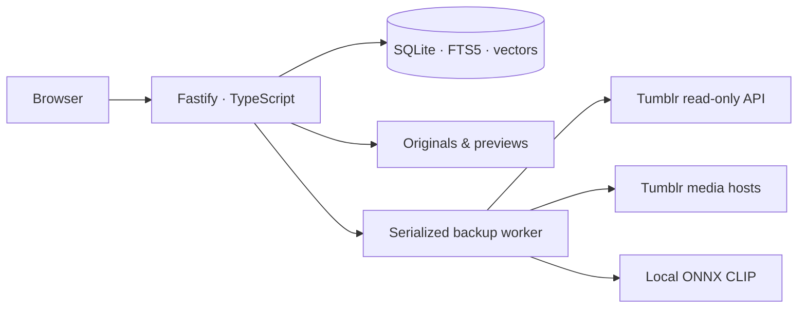

# Small enough to own

One Node process serves the compiled React application, the JSON API, OAuth callbacks and local media. A single private directory holds configuration, SQLite, originals, previews, the model cache and snapshots. No Python service or external database is required.

`src/config.ts` handles private atomic configuration and password hashing. It refuses a second first-run setup in the same synchronous step that sets the password. `server.ts` owns sessions, Host/Origin checks, the one-time setup code for exposed vaults and API routing. `throttle.ts` slows repeated password failures per client and across the vault, capped at one minute. `tumblr.ts` limits access to Tumblr reads and serialized OAuth refresh. A refused refresh grant still keeps a rotated refresh token, and its access token is never stored. `sync.ts` records metadata pagination checkpoints, respects quota waits and keeps a single active pipeline. `lock.ts` prevents two app processes opening the same directory. While holding that lock, startup removes temporary files that a crash left behind. `durable.ts` flushes files and their directory entries.

`store.ts` retains full source JSON and per-account membership separately from posts. Original/reblog lineage establishes collection identity; shared images do not. Filtering and text/vector matching operate on saved versions, then grouping precedes total/pagination. SQL performs this ranking and grouping (`ROW_NUMBER() OVER (PARTITION BY group_id …)`) on compact columns. Only the 24 entries on the page are then loaded, in a fixed number of batched queries. FTS5 uses BM25 weights title 5, tags 3, body 1, with deterministic timestamp/ID ties. `fts_doc` maps each post to its FTS rowid, so an update replaces one row by rowid instead of scanning the index. The schema version is in `PRAGMA user_version`; `migrate()` upgrades older vaults in place, and a cheap check on open repairs the map if an older release has written to the database. A page of records commits as one transaction. Dates cover inclusive UTC days. Profile-scoped facets and media coverage use only selected memberships and count shared media once.

`media.ts` validates every URL and redirect, streams bounded files to temporary paths and hashes originals. It flushes each file and its directory entry before installing it under a content-addressed name and recording it as saved. Previews are created afterwards from the saved original. A decode failure is recorded as unsupported content. A storage failure is recorded and retried on the next run without downloading again. If a recorded original has disappeared, it is queued for download. It never forwards Tumblr OAuth to media hosts. Non-Tumblr embeds remain in source JSON and are reported unavailable.

`ml.ts` uses lazy Transformers.js CLIP text/vision models and normalized 512-dimensional float vectors stored in SQLite. Transformers.js and ONNX Runtime are optional dependencies. A text-only install explains how to add them instead of failing to start. Local and Immich model identifiers are distinct. Cosine ranking is an exact scan within the chosen profile. It streams one vector at a time and scores each image once. It is not an ANN service, so time still grows linearly on very large archives. Only available indexed image previews participate. Model failures and missing reference vectors have explicit errors, not normal empty results.

Backup stages are metadata → originals → previews → optional image indexing → snapshot. Each account's metadata is read independently. A failing account is reported on its profile, and the other accounts and downstream stages still run. Interrupted metadata resumes a saved page; interrupted media/indexing keeps completed files/vectors. Only an interrupted full backup whose metadata pass read every account may resume past metadata. `partial` means some sources, accounts or previews are unavailable. `failed` means no selected account could be read, or a stage stopped the run. A completed metadata pass is not a guarantee that the API exposed every historical post or like. Snapshot creation uses SQLite’s online backup API and an atomic replacement; it does not independently back up originals.

The client keeps applied search state in the URL. A single form owns the current query/filter draft. Detail is a dialog over the retained collection; browser Back and close return to its opening context. All source content is plain text rendered by React. The image viewer uses local previews; originals are separate downloads.

## Deliberate limits

This is a single-operator/household tool, not a hosted multi-tenant platform. Profiles share one password and archive. There is no public-internet hardening claim, encrypted credential store, OCR, official-export ZIP importer, arbitrary-host fetcher, cloud synchronization or guaranteed full restore. SQLite and its lock belong on one local machine. Use the full-folder backup process in the installation guide and protect the credentials it contains.
