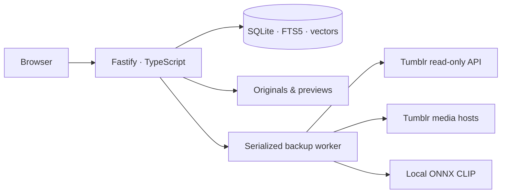

# Small enough to own

One Node process serves the compiled React application, the JSON API, OAuth callbacks and local media. A single private directory holds configuration, SQLite, originals, previews, the model cache and snapshots. No Python service or external database is required.

`src/config.ts` handles private atomic configuration and password hashing. `server.ts` owns sessions, Host/Origin checks and API routing. `tumblr.ts` limits access to Tumblr reads and serialized OAuth refresh. `sync.ts` records metadata pagination checkpoints, respects quota waits and keeps a single active pipeline. `lock.ts` prevents two app processes opening the same directory.

`store.ts` retains full source JSON and per-account membership separately from posts. Original/reblog lineage establishes collection identity; shared images do not. Filtering and text/vector matching operate on saved versions, then grouping precedes total/pagination. FTS5 uses BM25 weights title 5, tags 3, body 1, with deterministic timestamp/ID ties. Dates cover inclusive UTC days. Profile-scoped facets and media coverage use only selected memberships and count shared media once.

`media.ts` validates every URL and redirect, streams bounded files to temporary paths, hashes originals, installs content-addressed files and creates sharp previews. It never forwards Tumblr OAuth to media hosts. Non-Tumblr embeds remain in source JSON and are reported unavailable.

`ml.ts` uses lazy Transformers.js CLIP text/vision models and normalized 512-dimensional float vectors stored in SQLite. Local and Immich model identifiers are distinct. Cosine ranking is an exact scan within the chosen profile; it is not an ANN service and may become slow on very large archives. Only available indexed image previews participate. Model failures and missing reference vectors have explicit errors, not normal empty results.

Backup stages are metadata → originals → optional image indexing → snapshot. Interrupted metadata resumes a saved page; interrupted media/indexing keeps completed files/vectors. `partial` means some sources are unavailable. A completed metadata pass is not a guarantee that the API exposed every historical post or like. Snapshot creation uses SQLite’s online backup API and an atomic replacement; it does not independently back up originals.

The client keeps applied search state in the URL. A single form owns the current query/filter draft. Detail is a dialog over the retained collection; browser Back and close return to its opening context. All source content is plain text rendered by React. The image viewer uses local previews; originals are separate downloads.

## Deliberate limits

This is a single-operator/household tool, not a hosted multi-tenant platform. Profiles share one password and archive. There is no public-internet hardening claim, encrypted credential store, OCR, official-export ZIP importer, arbitrary-host fetcher, cloud synchronization or guaranteed full restore. SQLite and its lock belong on one local machine. Use the full-folder backup process in the installation guide and protect the credentials it contains.
